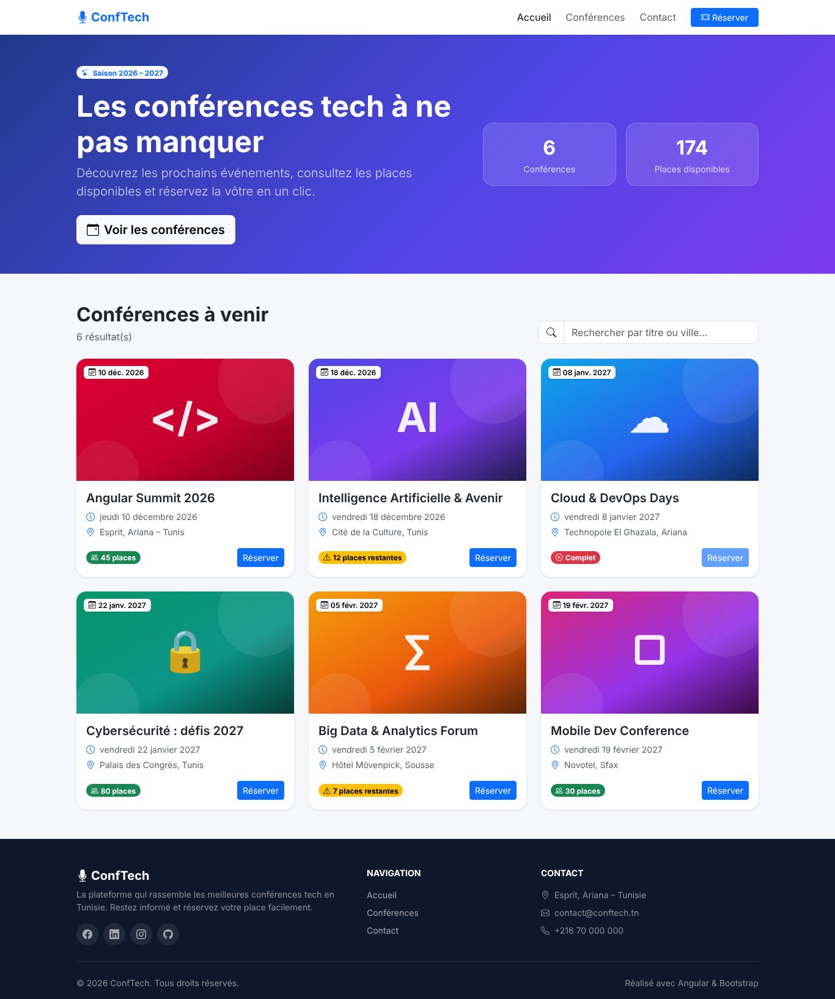

# ConfTech – Application Angular (Cours n°2 : Composants & Signals)

Application Angular (standalone + Signals + control flow `@for` / `@if`) stylée avec **Bootstrap 5** et **Bootstrap Icons**.

## Travail réalisé
- Composant **Home** (`src/app/components/home`) appelé dans le composant racine `App` (`<app-home />`).
- Liste statique de conférences stockée dans un `signal<Conference[]>` — interface `Conference` : `picture`, `title`, `date`, `adress`, `available_Places`.
- Affichage en cartes Bootstrap avec `@for (...; track conf.id)` et `@empty`, pipe `date` en français.
- Badge de places : `@if / @else if / @else` (Complet, places restantes, disponible).
- Recherche (signal + `computed`) et bouton « Réserver » (event binding + `update()`).
- Composants **Header** (navbar responsive) et **Footer** (finalisé : à propos, navigation, contact, réseaux sociaux, copyright).

## Lancer le projet
```bash
npm install
ng serve
```
Puis ouvrir http://localhost:4200

## Capture

